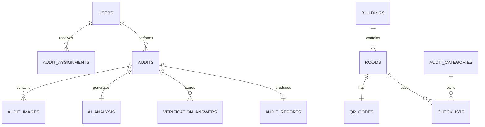

# 04_DATABASE_DESIGN.md

# Database Design

> **Version:** 1.0  
> **Purpose:** Define the logical database model, collections, relationships, indexing strategy, and design principles for the AI-Enabled Smart Infrastructure Audit and Inspection Management System.

---

# 1. Database Overview

## Database

- MongoDB Atlas
- Mongoose ODM

## Design Goals

- Flexible schema
- High read performance
- Modular collections
- Easy auditing
- Scalable relationships
- AI-ready metadata

The design favors **referenced documents** over deeply embedded documents to keep collections maintainable and scalable.

---

# 2. High-Level ER Diagram



---

# 3. Collections

## Core Collections

- users
- roles
- buildings
- rooms
- auditCategories
- checklists
- audits
- auditAssignments

## Verification Collections

- qrCodes
- gpsLocations
- auditImages
- aiAnalysis
- verificationAnswers

## Reporting Collections

- auditReports
- notifications
- activityLogs

---

# 4. Collection Definitions

## users

Purpose

Store user identities.

Fields

| Field | Type | Notes |
|------|------|------|
| _id | ObjectId | Primary Key |
| name | String | Required |
| email | String | Unique |
| password | String | bcrypt hash |
| roleId | ObjectId | Reference roles |
| phone | String | Optional |
| status | String | Active / Disabled |
| createdAt | Date | Auto |
| updatedAt | Date | Auto |

Indexes

- email (unique)
- roleId

---

## roles

Stores RBAC roles.

Example

- Admin
- Auditor

---

## buildings

Stores campus buildings.

Fields

- name
- code
- address
- description

---

## rooms

Represents inspectable locations.

Fields

| Field | Description |
|------|-------------|
| buildingId | Parent building |
| roomNumber | Visible identifier |
| roomType | Classroom/Lab/etc |
| latitude | Registered GPS |
| longitude | Registered GPS |
| referenceImages | Cloudinary URLs |
| qrCodeId | QR Reference |

Indexes

- buildingId
- roomNumber

---

## auditCategories

Examples

- Classroom
- Laboratory
- Hostel
- Library

---

## checklists

Stores reusable checklist templates.

Example

```json
{
  "title": "Classroom Audit",
  "items": [
    {
      "question":"Projector Working?",
      "type":"boolean",
      "mandatory":true
    }
  ]
}
```

---

## audits

Central collection.

Stores submitted audit information.

Fields

- assignmentId
- auditorId
- roomId
- categoryId
- status
- confidenceScore
- submittedAt

Statuses

- Pending
- In Progress
- Submitted
- Approved
- Review Required

Indexes

- auditorId
- roomId
- status
- submittedAt

---

## auditAssignments

Stores assignments.

Fields

- auditId
- auditorId
- assignedBy
- dueDate
- status

---

## qrCodes

Stores generated QR information.

Fields

- roomId
- encodedData
- version
- generatedAt

Never expose internal IDs directly inside QR payloads.

---

## gpsLocations

Stores captured GPS.

Fields

- auditId
- latitude
- longitude
- accuracy
- capturedAt

---

## auditImages

Stores uploaded images.

Fields

- auditId
- cloudinaryUrl
- capturedAt
- metadata

---

## aiAnalysis

Stores AI output.

Suggested structure

```json
{
  "roomClassification":"Classroom",
  "sceneDescription":"...",
  "objects":[
    "Board",
    "Projector",
    "Bench"
  ],
  "confidence":0.94
}
```

---

## verificationAnswers

Stores auditor answers.

Fields

- auditId
- question
- answer
- validationResult

---

## auditReports

Stores generated reports.

Fields

- auditId
- pdfUrl
- generatedAt

---

## notifications

Stores system notifications.

---

## activityLogs

Stores security and audit events.

Examples

- Login
- Logout
- Audit Started
- Audit Submitted
- AI Verification

---

# 5. Relationships

```text
Building
    │
    ├── Rooms
            │
            ├── QR Code
            ├── Checklist
            └── Audit

Audit
    │
    ├── Images
    ├── AI Analysis
    ├── Answers
    └── Report
```

---

# 6. Indexing Strategy

Create indexes on:

- email
- roomNumber
- buildingId
- auditorId
- roomId
- status
- assignedTo
- createdAt
- submittedAt

Compound indexes should be added after profiling production queries.

---

# 7. Validation Rules

Examples

Users

- Unique email
- Strong password

Rooms

- Valid coordinates
- Unique room number per building

Audits

- Assignment required
- Status enumeration
- Confidence between 0 and 100

---

# 8. Naming Conventions

Collections

camelCase

Documents

camelCase fields

ObjectId references

suffix with Id

Example

- roomId
- auditId
- buildingId

---

# 9. Soft Delete Strategy

Do not permanently delete production records.

Recommended fields

```text
isDeleted
deletedAt
deletedBy
```

---

# 10. Audit Trail

Maintain immutable logs for:

- Authentication
- Assignment
- Submission
- Approval
- AI Verification
- Administrative actions

---

# 11. Performance Considerations

- Use projections for large queries.
- Paginate dashboard endpoints.
- Store image URLs only.
- Avoid embedding large arrays.
- Use lean() where appropriate for read-only queries.

---

# 12. Backup & Recovery

- Enable MongoDB Atlas backups.
- Point-in-time recovery for production.
- Periodic export of critical collections.

---

# 13. Future Database Enhancements

- Redis caching
- Archive collections
- Time-series collection for GPS
- Vector database for AI embeddings
- Multi-tenant partitioning

---

# 14. Related Documents

- README.md
- 01_PROJECT_OVERVIEW.md
- 02_SYSTEM_ARCHITECTURE.md
- 03_TECH_STACK.md
- 05_BACKEND_GUIDELINES.md
- 08_API_SPECIFICATION.md
