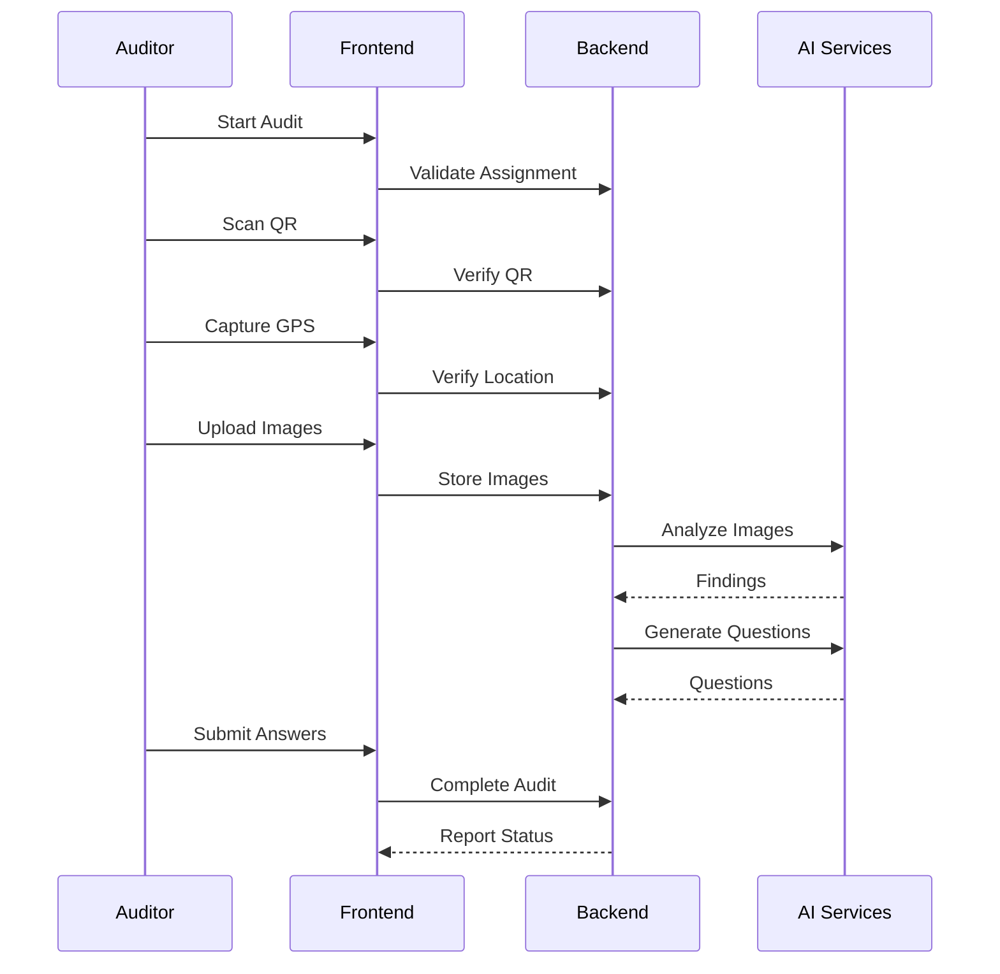

# 08_AUDIT_WORKFLOW.md

# Audit Workflow

> **Version:** 1.0  
> **Purpose:** Define the complete end-to-end audit execution lifecycle, from assignment to report generation, including AI-assisted verification and approval flow.

---

# 1. Workflow Objectives

The audit workflow must ensure:

- Authentic room verification
- Live auditor presence
- Standardized inspections
- AI-assisted validation
- Traceable audit history
- Minimal manual intervention

---

# 2. High-Level Workflow

```text
Admin Creates Audit
        │
Assign Auditor
        │
Auditor Logs In
        │
View Assigned Audit
        │
Scan QR Code
        │
Verify QR Assignment
        │
Capture Live GPS
        │
Verify Location
        │
Capture Live Images
        │
AI Image Analysis
        │
Dynamic AI Questions
        │
Auditor Answers
        │
AI Confidence Scoring
        │
Submit Audit
        │
Generate Report
        │
Approve or Manual Review
```

---

# 3. Audit States

| State | Description |
|--------|-------------|
| Assigned | Audit allocated to an auditor |
| In Progress | Audit has started |
| Verification Pending | AI validation running |
| Submitted | Auditor completed submission |
| Approved | AI/Admin approved |
| Review Required | Requires manual review |
| Rejected | Audit rejected |

---

# 4. Admin Workflow

1. Create building and rooms.
2. Register room coordinates.
3. Upload reference images.
4. Configure checklist.
5. Assign audit.
6. Track audit status.
7. Review flagged audits.
8. Export reports.

---

# 5. Auditor Workflow

1. Authenticate.
2. View assigned audits.
3. Select assigned room.
4. Scan QR code.
5. Capture GPS.
6. Capture room images.
7. Complete checklist.
8. Answer AI-generated questions.
9. Submit audit.

---

# 6. QR Verification

Objectives:

- Confirm correct room
- Prevent fake submissions
- Prevent cross-room inspections

Validation:

- QR exists
- QR belongs to assigned room
- QR is active
- Audit is assigned

Failure should terminate the workflow.

---

# 7. GPS Verification

Capture:

- Latitude
- Longitude
- Accuracy
- Timestamp

Compare captured coordinates with registered room coordinates.

Possible outcomes:

- Verified
- Borderline
- Failed

---

# 8. Image Capture

Requirements:

- Live camera capture
- Multiple images
- Timestamp metadata
- Upload to Cloudinary
- Store URLs only

Recommended minimum:

- Entrance
- Wide room view
- Asset-focused image

---

# 9. AI Image Verification

The Vision Language Model should:

- Classify room
- Detect assets
- Describe scene
- Compare with reference images
- Identify anomalies

Output:

```json
{
  "roomType":"Laboratory",
  "confidence":0.95,
  "detectedAssets":[
    "Projector",
    "Computer",
    "Chair"
  ]
}
```

---

# 10. Dynamic Question Generation

The LLM should generate contextual questions based on:

- Room type
- Detected assets
- Checklist
- AI observations

Example:

- Is the projector operational?
- How many computers are available?
- Are emergency exits accessible?

---

# 11. Answer Validation

Evaluate answers using:

- Checklist rules
- AI observations
- Reasoning prompts

Flag inconsistencies for review.

---

# 12. Confidence Engine

Suggested factors:

| Factor | Weight |
|---------|-------:|
| QR Verification | 20% |
| GPS Match | 20% |
| Image Analysis | 35% |
| Answer Validation | 25% |

Example thresholds:

- ≥90: Auto Approve
- 70–89: Manual Review
- <70: Reject

---

# 13. Report Generation

Generate report containing:

- Auditor details
- Room information
- Checklist results
- Images
- AI findings
- Confidence score
- Final decision

Export as PDF.

---

# 14. Exception Handling

Handle:

- Invalid QR
- GPS unavailable
- Camera denied
- AI timeout
- Upload failure
- Network interruption

Allow resume where practical without compromising integrity.

---

# 15. Notifications

Notify:

- Auditor on assignment
- Admin on submission
- Admin on review-required audits
- Auditor on approval/rejection

---

# 16. Activity Logging

Log:

- Audit start
- QR verification
- GPS capture
- Image upload
- AI completion
- Submission
- Approval

---

# 17. Sequence Diagram



---

# 18. Future Enhancements

- Offline-first auditing
- Video verification
- Face verification
- Bluetooth beacon verification
- NFC-based room validation
- Predictive maintenance insights

---

# 19. Related Documents

- README.md
- 02_SYSTEM_ARCHITECTURE.md
- 04_DATABASE_DESIGN.md
- 05_BACKEND_ARCHITECTURE.md
- 07_AUTHENTICATION_AND_AUTHORIZATION.md
- 09_AI_MODULE.md
- 10_API_SPECIFICATION.md
