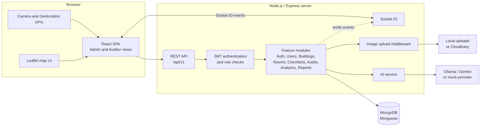

# Smart Infrastructure Audit and Inspection Management System

This repository contains a web application for planning and carrying out infrastructure inspections in educational institutions. Administrators manage users, buildings, rooms, checklists, and audit assignments. Auditors complete assigned inspections with QR, location, image, and checklist evidence. An AI service can analyze inspection images using a configured provider or return mock results for local development.

> This README describes the code currently in the repository. Some documents in `DOCS/` describe goals and future recommendations; they are not a guarantee that every proposed feature or deployment component is implemented.

## Contents

- [What the application does](#what-the-application-does)
- [Architecture](#architecture)
- [Technology stack](#technology-stack)
- [Repository structure](#repository-structure)
- [Audit workflow](#audit-workflow)
- [API overview](#api-overview)
- [Run locally](#run-locally)
- [Configuration](#configuration)
- [Useful commands](#useful-commands)
- [Related documentation](#related-documentation)

## What the application does

### Administrator workspace

- View the administration dashboard and reports.
- Manage users and their Admin or Auditor roles.
- Maintain buildings and rooms, including room QR codes and location data.
- Create and manage audit categories and checklists.
- Assign rooms and checklists to auditors and review audit status.

### Auditor workspace

- View assigned work and audit history.
- Start an inspection and verify the room QR token.
- Capture device location and have it checked against the room location.
- Capture and upload inspection images using the device camera.
- Complete the assigned checklist and request AI image analysis.
- Submit the audit for review.

The application includes role-protected frontend routes and JWT-protected backend APIs. The backend also exposes a health endpoint and uses Socket.IO for selected audit and assignment events.

## Architecture

The application is a JavaScript client/server system organized as a modular Express application. The browser communicates with the API over REST and connects to the same backend for Socket.IO events.



The API server applies security headers, CORS, request logging outside production/test, JSON and URL-encoded body parsing, and a login rate limit. API routes are mounted under `/api/v1`; uploaded local files are served from `/uploads`.

## Technology stack

| Area | Technologies used |
|---|---|
| Frontend | React 19, Vite 8, JavaScript (JSX) |
| Styling | Tailwind CSS 3, PostCSS |
| Routing and access | React Router 7, protected role-aware routes |
| API client and forms | Axios, React Hook Form |
| Maps and charts | React Leaflet, Leaflet, Recharts |
| Reports | jsPDF |
| Backend | Node.js 18 or later, Express 4 |
| Database | MongoDB, Mongoose 8 |
| Authentication | JSON Web Tokens, bcrypt, role-based authorization |
| Image handling | Multer; local disk in mock/local mode or Cloudinary when configured |
| AI | Ollama or Gemini when configured; mock provider otherwise |
| Realtime | Socket.IO |
| API hardening and logs | Helmet, CORS, express-rate-limit, Morgan |
| Development and checks | Nodemon, Jest, Supertest, Oxlint |
| Database for local development | MongoDB using the repository's Docker Compose file, or a separate local/Atlas instance |

The client dependencies do not include shadcn/ui. Vercel and Render are discussed as possible hosting choices in the deployment documentation; this repository does not itself configure a deployment pipeline.

## Repository structure

```text
auditmanagement/
├── client/                         # React + Vite single-page application
│   ├── public/                     # Public static assets
│   ├── src/
│   │   ├── assets/                 # Images and frontend assets
│   │   ├── components/             # Shared UI, including protected routes
│   │   ├── context/                # Authentication context
│   │   ├── layouts/                # Admin and Auditor application shells
│   │   ├── pages/
│   │   │   ├── admin/              # Dashboard, users, buildings, rooms,
│   │   │   │                       # checklists, assignments, and reports
│   │   │   ├── auditor/            # Auditor dashboard and audit session
│   │   │   └── auth/               # Login
│   │   ├── services/               # Axios client and API service functions
│   │   ├── App.jsx                 # Client routes and role-protected pages
│   │   └── main.jsx                # Frontend entry point
│   ├── package.json
│   ├── tailwind.config.js
│   └── vite.config.js
├── server/
│   ├── src/
│   │   ├── config/                 # MongoDB connection and seed script
│   │   ├── middleware/             # Auth, errors, and image uploads
│   │   ├── modules/
│   │   │   ├── analytics/
│   │   │   ├── audits/
│   │   │   ├── auth/
│   │   │   ├── buildings/
│   │   │   ├── checklists/
│   │   │   ├── reports/
│   │   │   ├── rooms/
│   │   │   └── users/              # Feature controllers, routes, services,
│   │   │                           # repositories, and Mongoose models
│   │   ├── routes/                 # Root API route registration
│   │   ├── shared/
│   │   │   ├── ai/                 # Provider selection and AI calls
│   │   │   ├── errors/             # Shared application error
│   │   │   └── response/           # Standard API response formatter
│   │   ├── app.js                  # Express middleware and API setup
│   │   └── server.js               # HTTP server, MongoDB, and Socket.IO
│   ├── uploads/                    # Runtime local uploads; ignored by Git
│   ├── .env.example                # Backend environment variable template
│   └── package.json
├── DOCS/                           # Project and implementation documentation
├── docker-compose.yml              # Local MongoDB service
├── README_LOCAL_RUN.md             # Additional local run instructions
└── .gitignore
```

Each backend feature module is not identical: for example, the reports module currently contains routes only, while the audits module includes controllers, services, repositories, and models. The tree above summarizes the current code rather than a prescribed future structure.

## Audit workflow

```text
Admin creates room/checklist and assigns an auditor
                         |
                         v
Auditor opens assignment and starts an audit
                         |
                         v
QR token verification --> GPS verification against room location
                         |
                         v
Live camera capture --> image upload (local or Cloudinary)
                         |
                         v
AI image analysis (configured provider or mock)
                         |
                         v
Checklist completion --> audit submission --> admin review/status update
```

QR and GPS verification, live-capture checks, image upload, AI analysis, checklist submission, and audit status are represented in the application. The exact automated approval/confidence-scoring pipeline described in some design documents should be treated as a proposal unless confirmed in the current implementation.

## API overview

The backend health check is `GET /health`. The versioned API base path is `/api/v1`; the main resource groups include:

| Prefix | Purpose |
|---|---|
| `/auth` | Login, token refresh, logout, and profile |
| `/users` | User and role management |
| `/buildings` | Building management |
| `/rooms` | Room and QR-code management |
| `/checklists` | Audit categories and checklists |
| `/audits` | Assignments, inspection sessions, and status |
| `/analytics` | Dashboard analytics |
| `/reports` | Report endpoints |
| `/qr/verify`, `/gps/verify` | Auditor verification endpoints |
| `/images/upload`, `/ai/analyze` | Image upload and AI analysis |

Auditor/admin access is enforced by backend authentication and role middleware as appropriate. Consult the route files and [API specification](./10_API_SPECIFICATION.md) for the current endpoint details.

## Run locally

### Prerequisites

- Node.js 20.19 or later (or 22.12 or later) and npm for the Vite 8 frontend. The backend itself declares support for Node.js 18 or later.
- MongoDB locally, MongoDB Atlas, or Docker Desktop with Docker Compose.

### Setup

1. Start a MongoDB database. To use the included Compose configuration, run from the repository root:

   ```sh
   docker compose up -d
   ```

2. Create `server/.env` from `server/.env.example`. Set `MONGO_URI` to your database. The client defaults to `http://localhost:5001/api/v1`, so use `PORT=5001` in `server/.env` for the default local pairing, or set the client's `VITE_API_URL` to match your selected server port.

3. Install dependencies and seed the development database:

   ```sh
   cd server
   npm install
   npm run seed
   ```

4. Start the backend in a terminal from `server/`:

   ```sh
   npm run dev
   ```

5. In another terminal, install dependencies and start the frontend:

   ```sh
   cd client
   npm install
   npm run dev
   ```

6. Open the Vite URL printed in the terminal (normally `http://localhost:5173`) and sign in with a development account created by the seed script.

The seed script creates Admin and Auditor demo users and starter audit categories. It is intended for development; do not use the seeded credentials in a deployed environment. The longer [local run guide](../README_LOCAL_RUN.md) contains additional notes.

## Configuration

Backend variables are documented in [`server/.env.example`](../server/.env.example). Important settings include:

- `PORT`, `NODE_ENV`, `CLIENT_URL`, and `MONGO_URI`.
- `JWT_SECRET`, `JWT_REFRESH_SECRET`, and token expiry settings.
- `CLOUDINARY_CLOUD_NAME`, `CLOUDINARY_API_KEY`, and `CLOUDINARY_API_SECRET`.
- `AI_PROVIDER`, `OLLAMA_API_KEY`, `OLLAMA_HOST`, `OLLAMA_MODEL`, and `GEMINI_API_KEY`.
- `GPS_TOLERANCE_METERS`.

When no valid AI provider credentials are configured, or when `AI_PROVIDER=mock`, the AI service selects mock responses. When Cloudinary is not configured (or uses the mock cloud name), image uploads use local disk storage under `server/uploads`. Local uploads are ignored by Git. Never commit real `.env` files or credentials.

The frontend API URL can be overridden with `VITE_API_URL`; otherwise it uses `http://localhost:5001/api/v1`.

## Useful commands

Run these from the corresponding `client/` or `server/` directory:

| Command | Directory | Purpose |
|---|---|---|
| `npm run dev` | `client/` | Start the Vite development server |
| `npm run build` | `client/` | Build the frontend for production |
| `npm run lint` | `client/` | Run Oxlint |
| `npm run dev` | `server/` | Start the backend with Nodemon |
| `npm start` | `server/` | Start the backend with Node.js |
| `npm run seed` | `server/` | Seed roles, categories, and demo users |
| `npm test` | `server/` | Run the configured Jest command |

## Related documentation

- [Project overview](./01_PROJECT_OVERVIEW.md)
- [System architecture](./02_SYSTEM_ARCHITECTURE.md)
- [Technology stack](./03_TECH_STACK.md)
- [Database design](./04_DATABASE_DESIGN.md)
- [Backend architecture](./05_BACKEND_ARCHITECTURE.md)
- [Frontend architecture](./06_FRONTEND_ARCHITECTURE.md)
- [Authentication and authorization](./07_AUTHENTICATION_AND_AUTHORIZATION.md)
- [Audit workflow](./08_AUDIT_WORKFLOW.md)
- [AI module](./09_AI_MODULE.md)
- [API specification](./10_API_SPECIFICATION.md)
- [Project structure](./11_PROJECT_STRUCTURE.md)
- [Coding standards](./12_CODING_STANDARDS.md)
- [Security guidelines](./13_SECURITY_GUIDELINES.md)
- [Testing strategy](./14_TESTING_STRATEGY.md)
- [Deployment guide](./15_DEPLOYMENT_GUIDE.md)
- [Local run guide](../README_LOCAL_RUN.md)
